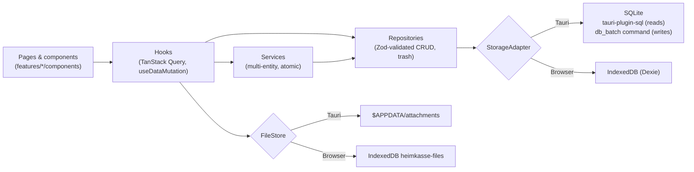

<div align="center">

# Heimkasse

**A local-first household finance manager built for life in Germany.**

Track spending, budgets, contracts, meter readings and Nebenkosten. Runs fully offline as a desktop app or in the
browser, in German or Persian (RTL).


</div>

---

## Contents

- [Why Heimkasse](#why-heimkasse)
- [Highlights](#highlights)
- [Features](#features)
- [Tech stack](#tech-stack)
- [Getting started](#getting-started)
- [Scripts](#scripts)
- [Architecture](#architecture)
- [Data model & storage](#data-model--storage)
- [Privacy & security](#privacy--security)
- [Quality & testing](#quality--testing)
- [Project structure](#project-structure)

## Why Heimkasse

Most budgeting apps are cloud services built for a generic market. Running a household in Germany involves things
they don't handle: **cancellation deadlines** under § 309 BGB, **Nebenkostenabrechnungen**, **meter readings**,
**tax-relevant expenses** and bank CSV exports in a dozen formats.

Heimkasse handles all of this **on your own device**. It has no account, no server, no analytics and makes no network
requests.

## Highlights

- 🔒 **Local-first and private.** SQLite on the desktop and IndexedDB in the browser. Your data never leaves the device.
- 🇩🇪 **Built for Germany.** Contract deadlines, utility settlements, meter consumption, tax categories and presets
  for Sparkasse, N26, DKB, ING and Commerzbank CSV exports.
- 🌍 **Bilingual with full RTL.** German by default, Persian with right-to-left layout, Persian digits and an
  optional Jalali calendar.
- ♿ **Accessible.** Every route is tested automatically against WCAG 2.2 AA in both languages and both themes,
  including a 320 px reflow check.
- ⚛️ **Atomic and safe.** Writes that touch several records commit in a single transaction. Every row is validated
  by the same Zod schemas the forms use.
- 🖥️ **One codebase, two runtimes.** A static Next.js export runs both in a native Tauri 2 window and in any modern
  browser.

## Features

| Area                      | What it does                                                                                                                                                                  |
| ------------------------- | ----------------------------------------------------------------------------------------------------------------------------------------------------------------------------- |
| **Dashboard**             | Balance across accounts, income/expense/savings rate vs. last month, budget status, upcoming payments, cancellation deadlines, top categories                                 |
| **Transactions**          | Virtualized list grouped by day, search and filters, create/edit/duplicate, bulk delete and re-categorize, undo, receipts, CSV/PDF export                                     |
| **Accounts & categories** | Colors and icons, subcategories, keyboard-accessible reordering, archive instead of delete when in use, German built-in categories                                            |
| **Recurring payments**    | Weekly to yearly rules, booked automatically on start; pause, skip once, edit future occurrences                                                                              |
| **Budgets**               | Monthly budget per category (incl. subcategories), configurable budget month start, alerts at the threshold and at 100 %                                                      |
| **Reports**               | Monthly/yearly by category, trends, income vs. expense, net worth. Every chart has an accessible data table. CSV/PDF export                                                   |
| **Contracts (Verträge)**  | Latest cancellation date from start, minimum term, notice period and auto-renewal; reminders 30/14/3 days ahead (toast + system notification); optional linked recurring rule |
| **Meters & Nebenkosten**  | Readings with plausibility checks, consumption and yearly cost projection, settlement vs. prepayments with a suggested new prepayment                                         |
| **Tax helper**            | Tag bookings with German tax categories; yearly report with CSV/PDF export                                                                                                    |
| **Savings goals**         | Deposits and withdrawals, progress, projected completion date                                                                                                                 |
| **Bank CSV import**       | Encoding, delimiter, header, date and number detection; column mapping with preview; bank presets and your own presets; import rules; duplicate detection; review screen      |
| **Data management**       | Validated JSON backup/restore incl. receipts, scheduled backups to a folder (desktop), trash with restore, delete all data, optional app lock                                 |
| **Settings**              | Language (de/fa), light/dark theme, Persian digits, Jalali display, first weekday, budget month start day, currency                                                           |

## Tech stack

| Layer         | Technology                                                                                                     |
| ------------- | -------------------------------------------------------------------------------------------------------------- |
| UI            | React 19, Next.js 16 (App Router, static export), CSS Modules with design tokens, Radix UI, lucide-react, cmdk |
| State & data  | TanStack Query, TanStack Table and Virtual, Zustand                                                            |
| Forms         | React Hook Form + Zod 4 (schemas shared with the repositories)                                                 |
| i18n          | i18next with typed keys, `Intl` formatters, date-fns + date-fns-jalali                                         |
| Charts        | Recharts (lazy-loaded, with table fallback)                                                                    |
| Desktop       | Tauri 2 (Rust): SQL (SQLite), dialog, fs, notification and persisted-scope plugins                             |
| Browser store | IndexedDB via Dexie                                                                                            |
| Export        | German-format CSV; a custom PDF writer with canvas-rendered A4 pages (correct Persian shaping offline)         |
| Testing       | Vitest, Testing Library, fake-indexeddb, `node:sqlite`, Playwright, axe-core                                   |
| Tooling       | TypeScript (strict, no `any`), ESLint (incl. jsx-a11y), Prettier                                               |

## Getting started

### Prerequisites

- **Node.js ≥ 22.5** and npm. The tests use `node:sqlite`. Developed with Node 24.
- **Rust (stable)** via [rustup](https://rustup.rs). Only needed for the desktop app.
- **macOS:** Xcode Command Line Tools (`xcode-select --install`).

### Install and run

```bash
npm install
npx playwright install chromium   # once, for the end-to-end tests

npm run dev                       # browser version → http://localhost:3000
npm run tauri:dev                 # native desktop window (needs port 3000 free)
```

### Build the desktop app

```bash
npm run tauri:build:mac           # → src-tauri/target/release/bundle/macos/Heimkasse.app
npm run tauri:build               # all bundle targets for the current OS (.app + .dmg on macOS)
```

The first Tauri build compiles the Rust dependencies, which takes a few minutes. Later builds are fast. The macOS
bundle is not code-signed, so on first launch use right-click → **Open**.

> In development the sidebar also shows **Komponenten** (`/design/`), a live gallery of the design-system components.

## Scripts

| Command                 | Description                                                                    |
| ----------------------- | ------------------------------------------------------------------------------ |
| `npm run dev`           | Browser version with hot reload (data in IndexedDB)                            |
| `npm run tauri:dev`     | Desktop window with hot reload (data in SQLite)                                |
| `npm run build`         | Static export of the frontend to `out/`                                        |
| `npm run check`         | Typecheck, ESLint and unit tests. Must pass before every commit                |
| `npm run test:coverage` | Unit tests with coverage thresholds for the critical logic                     |
| `npm run test:e2e`      | Playwright against the static build (desktop + phone viewport, axe WCAG scans) |
| `npm run format`        | Format the codebase with Prettier                                              |

## Architecture



### Key design decisions

- **The UI never talks to storage.** Components use hooks. Hooks call repositories or services. Repositories validate
  every write with the same Zod schemas the forms use. `src/features/repositories.ts` is the composition root, and
  `StorageGate` picks the adapter for the runtime and runs migrations.
- **Atomic multi-entity writes.** Repositories expose `prepare*` operations. Services combine them and commit with
  `storage.write(ops)`, which is one SQLite transaction or one IndexedDB transaction. In Tauri, writes go through a
  custom Rust command (`db_batch`) because the SQL plugin's connection pool cannot guarantee `BEGIN`/`COMMIT`
  across calls.
- **One schema source.** Migrations are declarative (`src/lib/db/migrations`), interpreted by both adapters,
  versioned and idempotent. The current table definitions are derived from them. Released migrations are never
  edited; new ones are appended.
- **Pure, tested domain logic.** Balances, budget periods, report aggregation, contract deadlines, meter consumption,
  Nebenkosten, the tax report, goal projections, CSV parsing and duplicate detection, and backup validation each live
  in small side-effect-free modules with unit tests.
- **Money is exact.** Amounts are stored as integer cents. Meter prices use 1/1000 cent so ct/kWh tariffs stay
  precise. There is no floating-point arithmetic on money.
- **RTL by construction.** Only logical CSS properties are used. Directional icons flip automatically, and
  `<html lang/dir>` follows the selected language. A boot cache prevents a flash of the wrong language or theme.
- **Lean bundles.** Charts, the quick-add dialog and the command palette are lazy-loaded. The UI barrel is
  tree-shakable via `sideEffects`.

## Data model & storage

Every table has `id` (UUID), `created_at` and `updated_at` (ISO timestamps), and `deleted_at`, which marks soft-deleted
rows in the trash. Dates are `YYYY-MM-DD`.

`accounts` · `categories` · `transactions` · `recurring_rules` · `budgets` · `contracts` · `meters` ·
`meter_readings` · `utility_settlements` · `savings_goals` · `goal_contributions` · `attachments` · `import_rules` ·
`settings` (key → JSON)

| Runtime         | Location                                                                                |
| --------------- | --------------------------------------------------------------------------------------- |
| Desktop (macOS) | `~/Library/Application Support/app.heimkasse.desktop/` (`heimkasse.db`, `attachments/`) |
| Browser         | IndexedDB databases `heimkasse` and `heimkasse-files`                                   |

## Privacy & security

- **No network access.** The app has no telemetry, no remote fonts and no external APIs. The Tauri CSP allows no
  remote sources.
- **Minimal Tauri capabilities.** The app gets the SQL plugin, the `db_batch` command, save/open dialogs,
  notifications and file access only to paths picked in a dialog and to `$APPDATA/attachments`.
- **Backups.** A backup is one JSON file with all tables (incl. trash) and receipts. On restore, every row is checked
  against its schema and version before anything is written. Then all data is replaced in one transaction. Backups
  from newer app versions are refused.
- **Automatic backups (desktop).** Choose a folder, for example a cloud-synced one, and a daily or weekly schedule.
  Only the newest _N_ files are kept.
- **App lock.** An optional password, hashed with PBKDF2-SHA256 (310,000 iterations, random salt), with a back-off
  after failed attempts and an optional auto-lock after inactivity. It is a privacy screen, **not encryption**: anyone
  with access to the files can read the database. There is no password recovery. The lock screen offers to delete all
  data, after which a backup can be restored.

## Quality & testing

- **Static checks.** Strict TypeScript, ESLint with jsx-a11y and Prettier, all run by `npm run check`.
- **Unit and integration tests.** Vitest covers the domain logic, components and hooks. Repository and service tests
  run against **both** storage adapters: SQLite via `node:sqlite` and IndexedDB via `fake-indexeddb`.
- **Coverage gates.** The critical logic must keep at least 90 % line and 80 % branch coverage
  (`npm run test:coverage`).
- **End-to-end tests.** Playwright runs the main flows (transactions, insights, Germany features, data management) on
  desktop and phone viewports against the production build.
- **Accessibility.** An axe scan (WCAG 2.2 AA) runs on every route in German/light and Persian/dark, plus a 320 px
  reflow check, which corresponds to 200 % zoom.

## Project structure

```
src/
  app/                  Routes only (thin pages + error boundary per route), static export
  features/<feature>/   schemas.ts, repository.ts, service.ts, pure logic (+ tests), hooks.ts, components/
  components/ui/        Design-system components (Radix + CSS Modules)
  components/layout/    App shell, sidebar, bottom nav, command palette (navigation.ts = single nav source)
  components/providers/ Query client, storage gate, preference effects
  lib/db/               StorageAdapter, SQLite + IndexedDB adapters, migrations, BaseRepository, SQL builder
  lib/files/            FileStore for attachments (Tauri app data, IndexedDB, memory)
  lib/i18n/             i18next setup, de/fa locales, Intl formatters, number parsing
  lib/export/           CSV helpers, export document model, PDF writer, file saving
  lib/preferences/      Preference + UI stores, boot cache
  lib/validation/       Zod helpers and translatable validation messages
  styles/               Design tokens, themes, global styles
src-tauri/              Rust shell: plugins, db_batch command, CSP, capabilities
e2e/                    Playwright specs (flows, data management, accessibility, reflow)
docs/PROJECT_BRIEF.md   Original product requirements
```

---

<div align="center">
Built by Naser Ahmadi
</div>
