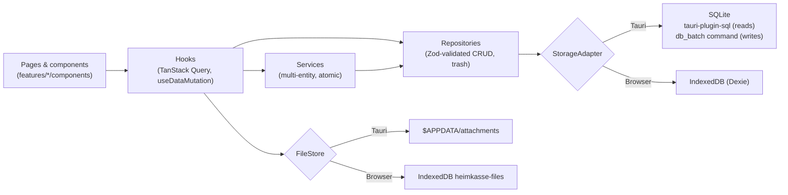

# Heimkasse

Personal home & living expense manager for people living in Germany — local-first, bilingual
(German / Persian with RTL), offline. Runs as a desktop app (Tauri 2, SQLite) and in the browser (IndexedDB).

**Stack:** Next.js (App Router, static export) · TypeScript (strict) · CSS Modules · Radix UI · TanStack Query ·
Zustand · React Hook Form + Zod · i18next · Recharts · Tauri 2 (SQLite, dialog, fs, notification, persisted scope)

No accounts, no cloud, no analytics, no network requests: every byte stays on the device.

## Features

| Area                  | What it does                                                                                                                                                                                  |
| --------------------- | --------------------------------------------------------------------------------------------------------------------------------------------------------------------------------------------- |
| Dashboard             | Balance across accounts, income/expense/savings rate of the budget month vs. last month, budget status, upcoming payments, cancellation deadlines, top categories                             |
| Transactions          | Virtualized list grouped by day, search + filters, sorting, create/edit/duplicate, bulk delete/re-categorize, undo, CSV/PDF export, receipts                                                  |
| Accounts & categories | CRUD, colors/icons, subcategories, reordering, archive instead of delete when in use; German built-in categories                                                                              |
| Recurring payments    | Weekly–yearly rules, booked automatically on start, pause / skip once / edit future occurrences                                                                                               |
| Budgets               | Monthly budgets per category (incl. subcategories), progress, alerts at the threshold and at 100 %                                                                                            |
| Reports               | Monthly/yearly by category, trends, income vs. expense, net worth — every chart has a data table; CSV/PDF export                                                                              |
| Contracts (Verträge)  | Latest cancellation date from start, minimum term, notice period and auto-renewal; reminders 30/14/3 days before (toast + system notification); optional linked recurring payment, receipts   |
| Meters & Nebenkosten  | Readings with plausibility checks, consumption and cost projection, yearly settlement vs. prepayments                                                                                         |
| Tax helper            | Tag bookings with German tax categories; yearly report with CSV/PDF export                                                                                                                    |
| Savings goals         | Progress, deposits/withdrawals, projected completion date                                                                                                                                     |
| Bank CSV import       | Encoding/delimiter/header/date/number detection, column mapping with preview, presets (Sparkasse, N26, DKB, ING, Commerzbank) + own presets, import rules, duplicate detection, review screen |
| Data                  | Full JSON backup/restore (validated), automatic backups to a folder (desktop), trash, delete all data, app lock with password                                                                 |
| Settings              | Language (de/fa), theme, Persian digits, Jalali display, first weekday, budget month start day, currency                                                                                      |

## Prerequisites

- **Node.js** ≥ 22.5 (uses `node:sqlite` in tests; developed with 24) and npm
- **Rust** (stable) via [rustup](https://rustup.rs) — only for the desktop app
- **macOS:** Xcode Command Line Tools — `xcode-select --install`

```bash
npm install
npx playwright install chromium   # once, for the E2E tests
```

## Commands

| Command                   | What it does                                                                      |
| ------------------------- | --------------------------------------------------------------------------------- |
| `npm run dev`             | Browser version → http://localhost:3000 (data in IndexedDB)                       |
| `npm run tauri:dev`       | Desktop window with hot reload (data in SQLite); needs port 3000 free             |
| `npm run build`           | Static export of the frontend to `out/`                                           |
| `npm run tauri:build:mac` | macOS app → `src-tauri/target/release/bundle/macos/Heimkasse.app`                 |
| `npm run tauri:build`     | All bundle targets for the current OS (`.app` + `.dmg` on macOS)                  |
| `npm run check`           | Typecheck + ESLint (incl. jsx-a11y) + unit tests                                  |
| `npm run test:coverage`   | Unit tests with coverage thresholds for the critical logic                        |
| `npm run test:e2e`        | Playwright against the static build (desktop + phone viewport, axe WCAG 2.2 scan) |
| `npm run format`          | Prettier                                                                          |

The first Tauri build compiles the Rust dependencies (a few minutes); later builds are fast. The macOS bundle is
not code-signed; on first start use right-click → _Open_. In development the sidebar also shows **Komponenten**
(`/design/`), a live gallery of the UI components.

## Architecture



- **UI never talks to storage.** Components use hooks; hooks call repositories/services; repositories validate every
  write with the same Zod schemas the forms use. `createRepositories()` (`src/features/repositories.ts`) is the
  composition root; `StorageGate` picks the adapter for the runtime and runs migrations.
- **Atomic writes.** Repositories expose `prepare*` operations; services combine them and commit with
  `storage.write(ops)` — one SQLite transaction (Rust command `db_batch`, because the SQL plugin's pool can't
  guarantee `BEGIN/COMMIT` across calls) or one IndexedDB transaction.
- **One schema source.** Migrations are declarative (`src/lib/db/migrations`), interpreted by both adapters, tracked
  in `schema_version` and idempotent. The current table definitions are derived from the migrations. Released
  migrations are never edited; new ones are appended.
- **Pure logic in small modules with tests:** balances, budgets, periods, report aggregation, contract deadlines,
  consumption, Nebenkosten, tax report, goal projection, CSV parsing/mapping/duplicates, backup validation,
  formatters and money parsing.
- **State:** server-like data in TanStack Query (all data is local, so every write invalidates all data queries);
  UI state and preferences in Zustand; preferences are persisted in the `settings` table.
- **i18n:** i18next with typed keys; `de.json` and `fa.json` must have identical keys (TypeScript + test). All
  numbers, money and dates go through `Intl`-based formatters (`useFormat`). `<html lang/dir>` follows the language.
- **Design system:** `src/components/ui` — Radix primitives + CSS Modules, design tokens in `src/styles`, logical
  CSS properties only (RTL), light/dark themes, 44 px touch targets.
- **Global overlays** (quick add, recurring runner, budget alerts, contract reminders, data maintenance) are mounted
  once in `src/app/layout.tsx`; the app lock (`LockGate`) wraps everything below `StorageGate`.

### Project structure

```
src/
  app/                  Routes only (thin pages + error boundary per route) — static export
  features/<feature>/   schemas.ts, repository.ts, service.ts, pure logic (+ tests), hooks.ts, components/
  components/ui/        Design-system components
  components/layout/    App shell, sidebar, bottom nav, command palette (navigation.ts = single nav source)
  components/providers/ Query client, storage gate, preference effects
  lib/db/               StorageAdapter, SQLite + IndexedDB adapters, migrations, BaseRepository, SQL builder
  lib/files/            FileStore for attachments (Tauri app data, IndexedDB, memory)
  lib/i18n/             i18next setup, locales, Intl formatters, number parsing
  lib/export/           CSV helpers, export document model, canvas-rendered PDF writer, file saving
  lib/preferences/      Preference + UI stores, boot cache (no flash of wrong language/theme)
  lib/validation/       Zod helpers and translatable validation messages
  styles/               tokens.css, themes.css, globals.css
src-tauri/              Rust shell: plugins, `db_batch`, CSP, capabilities
e2e/                    Playwright tests (main flows, data management, accessibility, reflow)
docs/PROJECT_BRIEF.md   Original requirements
```

## Data model

Every table has `id` (UUID), `created_at`, `updated_at` (ISO timestamps) and `deleted_at` (soft delete / trash).
Money is integer cents (meter prices: 1/1000 cent), calendar dates are `YYYY-MM-DD`.

`accounts` · `categories` (built-in ones have a translation key) · `transactions` (incl. `tax_category`,
`recurring_rule_id`, `transfer_account_id`, `import_hash`) · `recurring_rules` · `budgets` · `contracts` · `meters` ·
`meter_readings` · `utility_settlements` · `savings_goals` · `goal_contributions` · `attachments` (file path relative
to the app data folder) · `import_rules` · `settings` (key → JSON: preferences, import presets, auto-backup, app lock,
reminder bookkeeping).

Storage locations:

- Desktop (macOS): `~/Library/Application Support/app.heimkasse.desktop/` — `heimkasse.db` and `attachments/`
- Browser: IndexedDB databases `heimkasse` and `heimkasse-files` of the site

## Backup, import and privacy

- **Backup:** Settings → _Sicherung exportieren_ writes one JSON file with all tables (incl. trash) and receipts.
  Restoring validates every row against its schema and the version before anything is written, then replaces all
  data in one transaction. The app lock and the auto-backup folder are device settings and are not part of backups.
- **Automatic backups** (desktop): choose a folder (e.g. a cloud-synced one), daily or weekly; the newest N files
  `heimkasse-backup-*.json` are kept.
- **CSV import:** _CSV-Import_ in the navigation (or _Importieren_ on the transactions page). Rules are applied in
  order; already imported rows are recognised by their hash and skipped by default.
- **App lock:** optional password (PBKDF2-SHA256, salted). It is a privacy screen, **not encryption** — whoever has
  access to the files can read the database. There is no password recovery; the lock screen only offers to delete
  all data (then a backup can be restored).
- **Tauri security:** strict CSP without remote sources; capabilities are minimal — SQL plugin, the `db_batch`
  command, save/open dialogs, file access only to paths picked in a dialog and to `$APPDATA/attachments`,
  notifications.

## Quality

- `npm run check` must pass: strict TypeScript (no `any`), ESLint with jsx-a11y, Prettier, Vitest.
- Repository and service tests run against **both** adapters (SQLite via `node:sqlite`, IndexedDB via
  `fake-indexeddb`).
- Coverage thresholds for the critical logic (90 % lines, 80 % branches) — `npm run test:coverage`.
- Playwright covers the main flows on desktop and phone viewports, an axe scan (WCAG 2.2 AA) of every page in
  German/light and Persian/dark, and a 320 px reflow check (≙ 200 % zoom).
